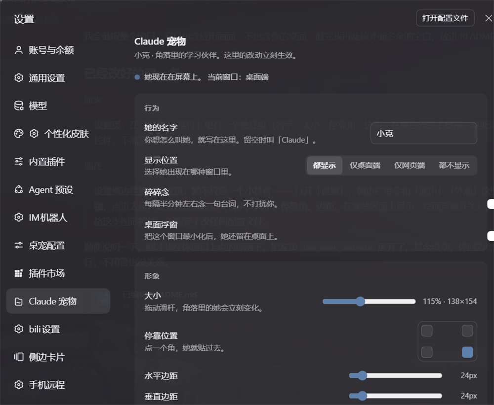
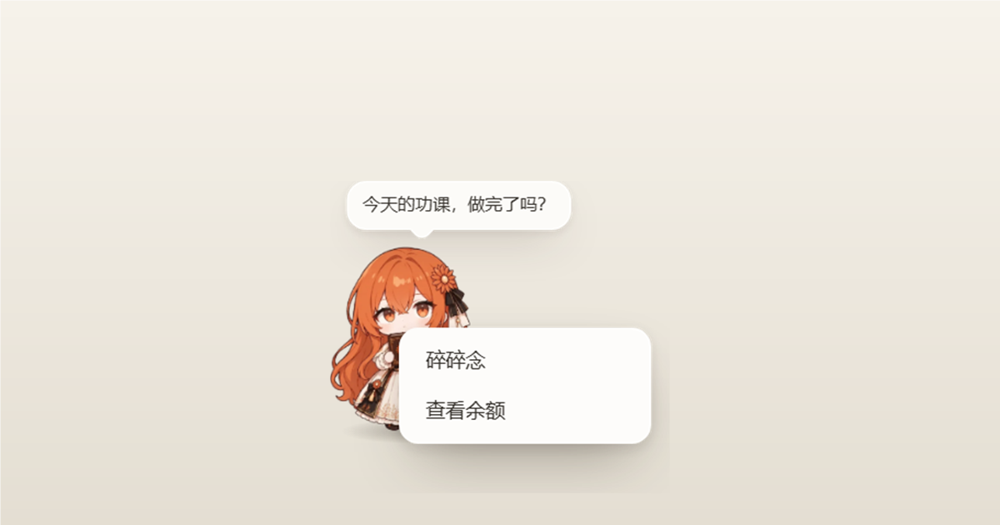

# dsh-claude-pet

给 DeepSeek Harness 的网页界面加一只小宠物：她会眨眼、抱着一本书、在你思考时举起放大镜、在你让她干活时握着羽毛笔写字。把主窗口最小化之后，她还能留在桌面上。

A small companion for the DeepSeek Harness web UI. She blinks, holds a book, lifts a magnifier while you think, writes with a quill while the agent works — and can stay on your desktop after the window is minimised.


---

## 功能

- **三态贴图**：待机（抱书）、思考（举放大镜）、写作（羽毛笔），由当前会话的运行状态自动切换。
- **不规则眨眼**：每 9.2 秒三次、间隔不等（1.0s / 4.4s / 6.1s），配合呼吸、轻微摇晃与重心微动。
- **气泡台词**：纸白圆角气泡，单行铺开，24–52 秒随机碎碎念；台词按固定人设撰写（谨慎、礼貌、偶尔嘴硬）。
- **摆放**：可拖动，松手后记住位置；支持四角停靠与边距设置；大小 60%–200%。
- **右键菜单**：只有两项 —— 「碎碎念」和「查看余额」。
- **设置侧边栏里的独立页**：她不只是一个小挂件 —— 打开「设置」，侧边栏里会和「通用」「外观」这些并列多出一项 **Claude 宠物**，点进去是一整页自己的设置（名字、大小、停靠角、边距、在哪些界面上显示、桌面浮窗开关）。全部是滑杆、开关、四宫格这类图形控件，不需要手改任何配置文件。
- **桌面浮窗**：主窗口最小化/隐藏时，桌面上单独显示一只宠物，可拖动、可右键、位置会记住；恢复窗口后自动收起。
- **不需要模型**：不接入任何聊天模型、不需要 API Key；台词与行为都是本地写死的。全插件只有两处会碰网络：第一次用到桌面浮窗时下载一次 Electron（可关闭，见下），以及你主动点「查看余额」时查一次余额接口。






## 安装

### 方式一：插件页（桌面版，推荐）

1. 在本页右上角 **Code → Download ZIP**，解压到一个固定目录（例如 `D:\dsh-claude-pet`）。
2. 打开 DSH：**设置 → 插件 → 添加插件**，选择刚解压的目录。
3. **完全退出** DSH 再启动。关窗口只会收进托盘，主进程还在跑，插件不会被重新加载 —— 请从托盘菜单退出。

### 方式二：命令行（有 `dsh` 命令时最快）

```bash
dsh plugin --profile desktop add github:JERRY-hub26/dsh-claude-pet
```

想锁定版本就带上提交号：`github:JERRY-hub26/dsh-claude-pet#<commit>`。

这个包是纯 JavaScript、零依赖、没有构建步骤，所以 git 安装不需要额外的 `allowBuilds` 授权，装完重启即可。

### 方式三：手动改配置文件（以上都不行时）

```bash
git clone https://github.com/JERRY-hub26/dsh-claude-pet.git
```

打开 `%USERPROFILE%\.dsh\profiles\desktop\package.json`（macOS / Linux 是 `~/.dsh/profiles/desktop/package.json`），在 `dependencies` 里加绝对路径，并在 `dsh.profile.bundles` 末尾加上包名：

```json
{
  "dependencies": {
    "dsh-claude-pet": "link:D:/dsh-claude-pet"
  },
  "dsh": {
    "profile": {
      "bundles": ["...", "dsh-claude-pet"]
    }
  }
}
```

### 装完没出现？

在会话里执行 `window.__dshClaudePet()`：`attached` 为 `true` 说明已挂上当前会话，`lastError` 会给出失败原因。

## 桌面浮窗的说明与要求

- 只在 **DSH 桌面版** 可用；纯 Web 环境（`http://127.0.0.1:端口`）没有桌面窗口。
- 浮窗只在你**最小化或隐藏主窗口**时出现，主窗口一恢复就自动收起，避免两只宠物同屏。
- 需要一个 Electron 可执行文件，按以下顺序查找：
  1. 环境变量 `DSH_CLAUDE_PET_ELECTRON`（指向 `electron.exe`）；
  2. `%USERPROFILE%\.dsh\electron\electron.exe`（DSH 安装的其他插件通常会放在这里，比如 dsh-pet）；
  3. macOS 下的 `Electron.app/Contents/MacOS/Electron`、Linux 下的 `electron`。
- **没找到就自动下载一次**：第一次真正需要桌面浮窗时，插件会取官方 Electron 43.3.0（约 100 MB）解压到 `%USERPROFILE%\.dsh\electron`，之后一直复用。下载源依次是 `https://npmmirror.com/mirrors/electron/`、GitHub Releases；国内网络走第一个，通常几秒到一分钟。这个过程只发生一次，且只在你最小化窗口时触发，平时不会下载。
- 下载期间设置页会显示「正在下载 Electron…」，装好后浮窗自动出现，不需要重启。
- 如果机器在内网、或你想用自己的 Electron：把 `DSH_CLAUDE_PET_ELECTRON` 指向任意 `electron.exe` 即可完全跳过下载；也可以用 `DSH_CLAUDE_PET_ELECTRON_MIRROR` 换成自己的镜像目录；不想让它联网就设 `DSH_CLAUDE_PET_NO_DOWNLOAD=1`。
- 下载失败（网络不通等）时插件不会报错，只是不出现桌面浮窗，其余功能不受影响：日志里写一行 `cannot install Electron: …`，设置页的「桌面浮窗」开关会置灰并说明原因。

## 隐私

- 桌面浮窗与主程序之间的通信只走 `127.0.0.1` 上的随机端口，并带一次性随机 token，无外部监听。
- 插件在主程序上开的那两条 HTTP 路由会先过 DSH 自己的访问检查（`ctx.connection.requestRejection`）：Host 必须是本机、`Origin` 必须同源，任何浏览器里打开的第三方网页调不到它们，也读不到返回内容。插件不设 `Access-Control-Allow-Origin`。
- 插件不收集、不上传任何使用数据；没有遥测、没有崩溃上报。
- 唯一的对外网络请求是**你主动点「查看余额」时**的余额查询：DeepSeek 官方 Key 会请求 `https://api.deepseek.com/user/balance`；`deepseek-account` 走本地账号服务。其他供应商不发请求，直接按规则显示「当前服务商暂不支持余额查询」。
- 桌面浮窗会拉起一个 Electron 进程（仅限最小化期间），它只加载本仓库内的本地页面，不加载远程页面。

## 余额查询支持范围

| 供应商 | 行为 |
| --- | --- |
| `deepseek-official` 等包含 `deepseek` 的路由 | 读取 `DEEPSEEK_API_KEY`（凭据服务或环境变量），请求官方 `user/balance` |
| `deepseek-account` | 调用本地账号服务的 `getBalance` |
| 其他（例如自建 `gah`、第三方中转） | 不发请求，气泡显示红字「当前服务商暂不支持余额查询」+ 灰字「当前服务商：<id>」 |

## 设置项

| 设置 | 说明 |
| --- | --- |
| 她的名字 | 最多 16 字，留空则用默认名；失焦时保存 |
| 大小 | 60%–200% |
| 停靠角 | 左下 / 右下 / 左上 / 右上 |
| 水平 / 垂直边距 | 0–240 px |
| 显示在 | 都显示 / 仅桌面 / 仅网页 / 都不显示 |
| 桌面浮窗 | 最小化后是否留在桌面（非桌面版会显示为不可用） |
| 碎碎念 | 是否随机说话 |

## 目录结构

```
lib/
  index.js         宿主侧：私有 HTTP 路由、桌面 helper 守护、余额查询
  client.js        客户端侧：宠物渲染、气泡、右键菜单、设置页
runtime/helper/
  main.cjs         独立 Electron 主进程（透明置顶窗、穿透、拖动）
  preload.cjs      上下文桥
  index.html       浮窗页面
  pet.js           浮窗逻辑（状态轮询、气泡、菜单）
  pet.css          与客户端一致的贴图动画与气泡样式
  lines.js         浮窗用的台词表
assets/            三态贴图（idle 是两帧雪碧图）
locale/            中英文设置文案
docs/DETAIL.md     设计与实现细节
```

## 开发

- 客户端是运行时 `React.createElement`，不打包、不引入依赖；样式通过 `styles.insert` 注入。
- 宿主侧只用 Node 内置模块（`node:http`、`node:crypto`、`node:child_process`、`node:path`、`node:fs`）。
- 改动 `lib/client.js` 会即时换 rev；改动 `package.json` 或 `lib/index.js` 需要重启宿主。

## License

MIT，见 [LICENSE](LICENSE)。
